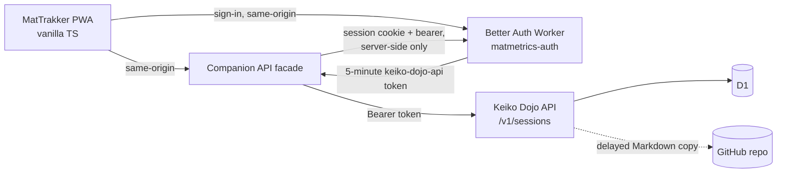

# MatTrakker

A lightweight, installable companion app for logging Judo practice sessions
from your phone, built as a Progressive Web App (PWA) in vanilla TypeScript,
HTML and CSS.

MatTrakker is the quick-capture companion to
[MatMetrics](https://github.com/CyanAutomation/matmetrics). It records
sessions through the
[Keiko Dojo](https://github.com/CyanAutomation/keiko-dojo) API and signs in
with the same MatMetrics account, so sessions logged here appear in MatMetrics
and the other way round.

> **Status: planning.** Nothing is implemented yet. This README records the
> intended scope, the architecture constraints found in the MatMetrics and
> Keiko Dojo repositories (as of 2026-11-22), and the decisions that must be
> made before the first line of code. Sections marked **Proposed** or **Open**
> are not settled.

## Contents

- [Goals and non-goals](#goals-and-non-goals)
- [How MatTrakker fits in](#how-mattrakker-fits-in)
- [Architecture constraints](#architecture-constraints)
- [Open decisions](#open-decisions)
- [Planned features](#planned-features)
- [Session data model](#session-data-model)
- [Offline and sync design](#offline-and-sync-design)
- [Tech stack](#tech-stack)
- [Proposed project structure](#proposed-project-structure)
- [Security principles](#security-principles)
- [Roadmap](#roadmap)
- [Development setup](#development-setup)
- [Related repositories](#related-repositories)
- [License](#license)

## Goals and non-goals

**Goals**

- Log a training session in a few taps, straight after practice, on a phone.
- Work offline on the mat and sync safely later, without duplicate sessions.
- Install to the home screen and launch like a native app.
- Stay small: vanilla TypeScript, HTML and CSS, with no UI framework.
- Reuse the existing MatMetrics identity and the Keiko Dojo session contract
  rather than inventing a parallel one.

**Non-goals**

- Replacing MatMetrics. Dashboards, training insights, plugins, GitHub backup
  configuration and Log Doctor stay in MatMetrics.
- Running its own user database or identity provider.
- Talking to the Keiko Dojo database, or any GitHub repository, directly.

## How MatTrakker fits in

| Component | Role | Notes |
| --- | --- | --- |
| **MatTrakker** (this repo) | Mobile-first PWA for capturing and reviewing sessions | Vanilla TypeScript, HTML, CSS |
| **MatMetrics** | Full web app and home of the Better Auth Worker | Next.js; owns sign-in (password and passkey) and the `matmetrics-api` token |
| **Keiko Dojo** | User-scoped Judo session API and domain service | Cloudflare Workers and D1; REST contract in `openapi.yaml` |



The facade box is the key architectural question; see the next section.

## Architecture constraints

These come from reading the sibling repositories, so they describe what exists
today rather than what we would like.

1. **The browser cannot call Keiko Dojo directly.** Keiko only accepts EdDSA
   JWTs with audience `keiko-dojo-api`, issued by Better Auth, with a maximum
   lifetime of five minutes. No CORS headers are emitted by Keiko's source, and
   its `/mcp` endpoint rejects requests whose `Origin` differs from its own.
2. **Keiko tokens are minted server-side only.** MatMetrics' Auth Worker
   issues them at an internal endpoint (`/__internal/keiko-token`) that
   requires an allowlisted `Origin`, `Sec-Fetch-Site: same-origin`, a valid
   Better Auth session cookie, and a MatMetrics bearer token for the same user.
   The token is never returned to the browser. See
   [ADR 0002](https://github.com/CyanAutomation/keiko-dojo/blob/main/docs/decisions/0002-identity-and-revocation.md).
3. **The session cookie is host-only.** It is not shared across subdomains,
   and the project deliberately avoids parent-domain cookies and broad CORS.
4. **Origins are allowlisted.** The Auth Worker trusts an explicit list of
   frontend origins. A new origin needs to be added there before sign-in or
   token exchange works from it.
5. **Passkeys are bound to the origin they were registered on.** The WebAuthn
   RP ID is currently `matmetrics-teal.vercel.app`. A new domain cannot reuse
   existing passkeys without the staged migration in MatMetrics'
   `passkey-domain-migration.md`.
6. **Keiko is not yet the store for every account.** Only accounts in the
   server-side `KEIKO_SESSION_CUTOVER_USER_IDS` allowlist use Keiko; other
   accounts still use MatMetrics' GitHub Markdown path.
7. **Sign-up is currently gated.** Email and password sign-up is disabled by
   default, so MatTrakker will initially serve existing MatMetrics accounts.

MatMetrics' own
[Companion domain ADR](https://github.com/CyanAutomation/matmetrics/blob/main/docs/architecture/adr-companion-domain-auth.md)
addresses this app directly. Its guidance, which this README adopts: the
Companion uses its own same-origin API facade, never sends browser cookies or
long-lived credentials to Keiko, and avoids cross-origin credentialed `fetch`
and permissive CORS. That ADR is still marked as pending approval.

## Open decisions

### 1. How does the PWA reach Keiko Dojo?

| Option | Description | Trade-offs |
| --- | --- | --- |
| **A. Own thin facade** (matches the ADR) | A small TypeScript service at `/companion/api/*` performs the token exchange and forwards to Keiko `/v1` | Clean boundary and full control; new backend to build and run; serves only Keiko-allowlisted accounts |
| **B. Reuse MatMetrics' session API** | Serve the PWA from the MatMetrics origin and call its existing same-origin `/api/sessions/*` routes (`list`, `create`, `create-mode`, `[id]`) with the bearer from Better Auth | No new backend; works for Keiko and non-Keiko accounts; couples MatTrakker to MatMetrics' API shape and release cadence |

The PWA code stays vanilla TypeScript either way. Only the thin server layer
differs. **Recommendation:** confirm with the MatMetrics maintainers whether
option B is acceptable before building a facade, because it removes the largest
piece of new infrastructure.

### 2. Which origin does the PWA live on?

The ADR prefers a **shared origin with path routing** (the PWA at `/companion/`
beside MatMetrics) for the first release. It keeps requests same-origin,
preserves host-only cookies, and avoids a passkey migration. Separate
first-party origins are viable but need an explicit per-origin sign-in flow and
a trusted-origin entry in the Auth Worker. The domain and routing owner are not
yet approved.

### 3. Who can use it at launch?

If the PWA goes through option A, only accounts in the Keiko cutover allowlist
can save sessions. Decide whether that is acceptable or whether option B (or a
legacy-compatible path) is needed.

### 4. Build tooling

"Vanilla" is taken to mean no UI framework, not no build step. See
[Tech stack](#tech-stack) for the proposal.

## Planned features

**MVP**

- Sign in with the existing MatMetrics account (password or passkey).
- Log a session: date, category, effort (1 to 5), techniques, duration,
  description, notes and an optional video URL.
- Browse past sessions with filters (date range, category, effort) and
  cursor-based paging.
- Edit and delete sessions using revision-checked updates.
- Offline capture with a durable outbox and safe retry.
- Installable PWA: manifest, icons, offline app shell, update prompt.
- Visible sync status: pending, syncing, conflict, signed-out.

**Later**

- Training summary view from Keiko's analytics endpoint.
- Optional technique suggestions via MatMetrics' AI endpoint.
- Quick-log templates (for example, "Tuesday randori").
- Share or export a session.

**Out of scope (stays in MatMetrics):** GitHub backup connection, Log Doctor,
plugins, and detailed training insights.

## Session data model

The session shape is defined by Keiko's
[`openapi.yaml`](https://github.com/CyanAutomation/keiko-dojo/blob/main/openapi.yaml)
and [session contract](https://github.com/CyanAutomation/keiko-dojo/blob/main/docs/session-contract.md).
Keiko is authoritative; the PWA validates only for usability.

| Field | Type | Required | Rules |
| --- | --- | --- | --- |
| `id` | string | Server-generated if omitted | Up to 100 characters; letters, digits, `_`, `-` |
| `date` | string | Yes | Real calendar date, `YYYY-MM-DD` |
| `category` | enum | Yes | `Technical`, `Randori`, `Shiai`, `Cardio`, `S&C` |
| `effort` | integer | Yes | 1 (easy) to 5 (intense) |
| `techniques` | string[] | Yes | Trimmed, deduplicated, no empty values |
| `duration` | integer | No | Minutes, zero or more |
| `description` | string | No | Free text |
| `notes` | string | No | Free text |
| `videoUrl` | string | No | Absolute HTTP(S) URL, no credentials, no private hosts |

Note: MatMetrics' `CLAUDE.md` lists only three categories. Keiko and the
MatMetrics storage code use all five, and this app follows Keiko.

Reads return `{ session, revision }` records with a user-scoped `ETag`.
Updates and deletes must send that value in `If-Match`; a missing header
returns 428 and a stale one returns 412. Request bodies are limited to 64 KiB.

## Offline and sync design

Planned behaviour, modelled on the MatMetrics web queue and the Keiko
idempotency contract.

- **Outbox in IndexedDB.** MatMetrics uses a `localStorage` queue; its
  architecture notes recommend an IndexedDB outbox for a mobile client.
- **Idempotent creates.** Generate a UUID v4 `Idempotency-Key` for each logical
  create and persist it, with the frozen payload, before the first attempt.
  Reuse the same key on every retry. Keiko then replays the original `201`
  rather than creating a duplicate, and returns `409 idempotency_key_reuse` if
  a key is ever reused with a different payload.
- **Revision-aware edits.** Store the revision and `ETag` loaded with each
  session and send them with updates and deletes.
- **Retry policy.** Retry network failures, `408`, `429` (honour
  `Retry-After`) and `5xx`. Pause on `401` and `403` until the user signs in
  again. Mark `404`, `412` and `428` as conflicts for the user to resolve, and
  never retry them automatically.
- **Account scoping.** Key local data by account so a sign-out or account
  switch cannot leak or replay another user's queue.
- **Service worker.** Cache the app shell only, under a distinct cache prefix.
  Never cache authentication or API responses, and keep the worker's scope
  inside the app's path (for example `/companion/`).

## Tech stack

**Proposed**

- **Language:** TypeScript in strict mode, compiled for the browser.
- **UI:** plain HTML and CSS; small hand-written modules or Web Components for
  views; no framework.
- **Styling:** CSS custom properties, mobile-first, light and dark themes.
  Align design tokens with MatMetrics (its primary blue is `#006BAB` in light
  mode) so the two apps feel related.
- **Build:** `tsc` for type checking and `esbuild` for bundling.
- **Storage:** IndexedDB for the outbox and cached sessions.
- **Tests:** Node's built-in test runner for logic (as in MatMetrics), plus a
  browser-based end-to-end check of the install and offline flows.
- **Runtime:** Node.js 26 and npm 11, matching MatMetrics and Keiko Dojo.

## Proposed project structure

```text
src/
├── main.ts              # Entry point and routing
├── api/                 # Typed client for the facade or MatMetrics API
├── auth/                # Sign-in, session state, token handling
├── outbox/              # IndexedDB queue, idempotency keys, replay
├── views/               # Log, history, detail, settings
├── components/          # Reusable UI pieces
├── styles/              # Tokens and layout CSS
└── sw.ts                # Service worker (app shell only)
public/
├── index.html
├── manifest.webmanifest
└── icons/
test/
docs/
└── decisions/           # ADRs for the open decisions above
```

If option A is chosen, add a `facade/` directory for the server layer.

## Security principles

- No long-lived credentials in the browser. Keep short-lived tokens in memory
  rather than `localStorage`.
- The PWA never receives or stores a Keiko token. Token exchange stays
  server-side.
- No wildcard CORS and no cross-origin credentialed requests.
- Ownership always comes from the verified token. Never send an account ID or
  GitHub `owner`/`repo` to select data; Keiko ignores them.
- A strict Content Security Policy, and no inline scripts.
- Authenticated responses are `no-store` or private and never enter a shared
  cache.
- Do not log session text, tokens or cookies.

## Roadmap

1. **Decide.** Settle the open decisions above and record them as ADRs.
2. **Scaffold.** Project setup, TypeScript, build, lint, CI, and an installable
   shell with manifest and service worker.
3. **Authenticate.** Sign-in against the MatMetrics Auth Worker; sign-out and
   expiry handling.
4. **Record online.** Create, list, view, edit and delete against Keiko, with
   revision handling.
5. **Work offline.** Outbox, idempotent replay, conflict handling, sync status.
6. **Polish.** Accessibility audit, performance, update flow, icons and
   splash screens.
7. **Extend.** Summary view, technique suggestions, templates.

## Development setup

There is no code to run yet. Once the scaffold lands, this section will cover
prerequisites, environment configuration, the dev server, tests, and how to
sign in against a local or staging MatMetrics and Keiko stack.

For the backends, see
[MatMetrics `SETUP.md`](https://github.com/CyanAutomation/matmetrics/blob/main/SETUP.md)
and the
[Keiko Dojo README](https://github.com/CyanAutomation/keiko-dojo#local-development).

## Related repositories

- [CyanAutomation/matmetrics](https://github.com/CyanAutomation/matmetrics):
  the web app, Better Auth Worker and legacy storage paths.
- [CyanAutomation/keiko-dojo](https://github.com/CyanAutomation/keiko-dojo):
  the session API, its OpenAPI contract and operations guide.
